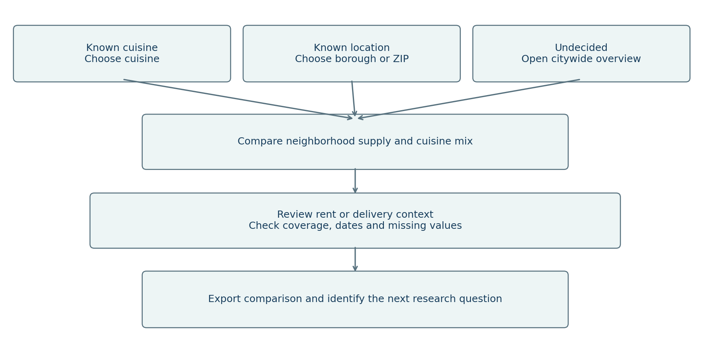
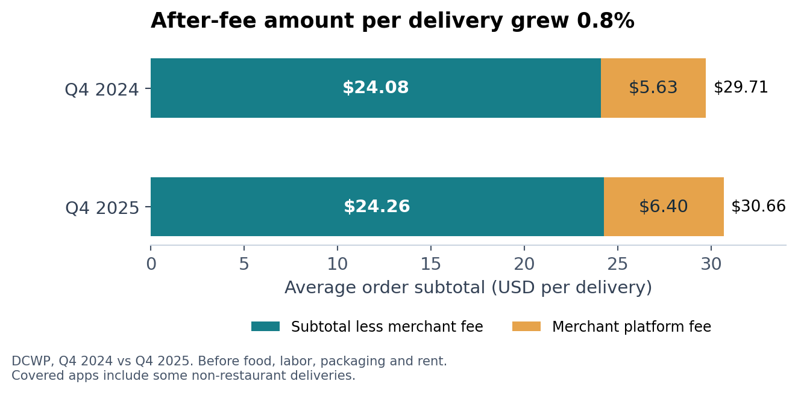
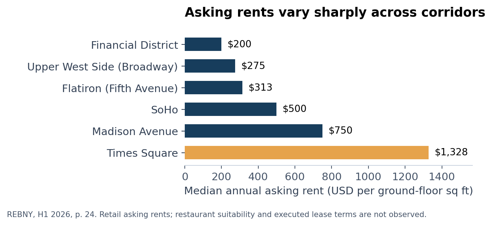
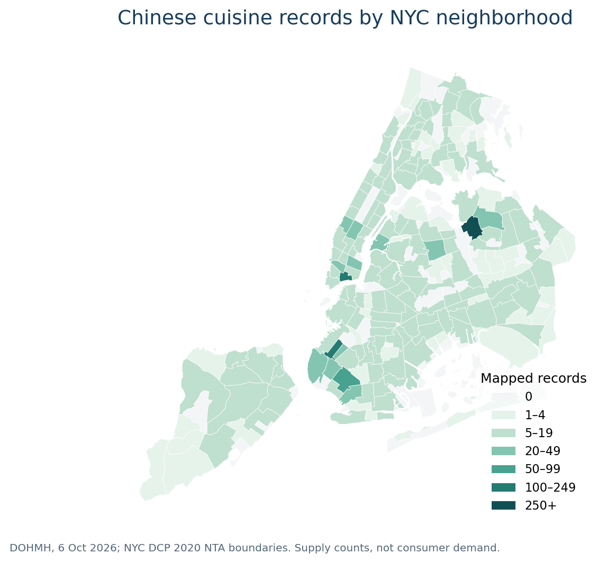

# NYC Restaurant Market Platform

## Final business analysis and prototype handoff

Bochao Liang | AI Business Analyst Intern | 13 October 2026

This project provides an evidence-based starting point for prospective restaurant owners and existing operators evaluating NYC concepts or locations. The delivered prototype supports three entry paths and compares restaurant supply, retail asking-rent context and delivery economics. It helps users decide what to investigate next. Commercial feasibility and restaurant success remain unvalidated.

### Business problem and objective

Useful evidence is distributed across inspection records and market reports with different dates, units and geographic coverage. Combining those figures without checking their definitions can produce misleading conclusions. The service makes comparable measures visible, adds neighborhood maps with explicit coverage, and lets users export an auditable comparison.

### Delivered scope

The package contains seven documented public sources, a reproducible Python and SQLite pipeline, 17 core CSV tables, eight analytical charts, an offline interactive HTML prototype and a business requirements package. The latter includes user journeys, requirements linked to acceptance criteria, KPI definitions, a risk and decision register, and a final review procedure.

### Initial recommendation

Use this release as an exploratory comparison platform. Delivery volume grew 18.3% between Q4 2024 and Q4 2025, while order subtotal less merchant platform fees grew only 0.8% per delivery [S2]. Rent benchmarks differ substantially across Manhattan corridors [S3]. These findings support showing costs beside activity and supply rather than treating a single high-growth or low-competition measure as an investment recommendation.

### Release boundary

This release reuses the reviewed 7 October market captures and adds official NTA boundaries retrieved on 13 October. The DOHMH record date is 6 October 2026. The prototype is a local HTML file. A native Tableau or Power BI workbook, hosted service and recommendation model are future implementation items. Stakeholder approval and end-user acceptance have not been recorded.

# Users and decision workflow

## Target users

| Starting point | Decision supported | Minimum input |
| --- | --- | --- |
| Concept known | Compare where that cuisine is recorded and narrow the next research area | Cuisine; borough or ZIP optional |
| Location known | Understand the area's recorded cuisine mix and compare alternatives | Borough or ZIP; cuisine optional |
| No fixed preference | Explore the citywide supply pattern and form an initial question | No input required |

An expansion analyst can use the same paths for an existing restaurant business. Chain-specific sales, catchment areas and site suitability require additional company or property data. The three profiles describe intended users; interviews have not yet validated them.

### Current workflow hypothesis

A user searches several public reports, copies figures into a spreadsheet, checks units and coverage manually, then tries to compare locations or concepts. This workflow is a hypothesis for user research. No measured baseline or interview evidence is claimed.

### Proposed workflow

Cuisine-first and location-first buttons load illustrative defaults, Chinese and Manhattan, which users can change. Entry buttons open the neighborhood map. Separate map filters control spatial supply; the supply table keeps its own borough and ZIP filters. Rent corridors and citywide delivery trends remain independent modules. The final action is an exported comparison and a human research decision; the prototype does not automatically recommend a location.

# Business requirements and priorities

## Needs translated into behavior

Business needs describe decisions users must make. Features implement those needs. The traceability register links each need to a feature, source, acceptance criterion and verification reference. Priority is a proposed release decision, subject to sponsor confirmation.

| ID | Priority | Business need | Implemented behavior |
| --- | --- | --- | --- |
| R01–03 | Essential | Start from a concept, area or no preference | Three entry paths with supply filters and cuisine mix |
| R04 | Essential | Compare occupancy assumptions | Rent comparison and floor-area calculator |
| R05 | Essential | Understand delivery economics | Quarter comparison including merchant fees |
| R06 | Essential | Judge evidence reliability | Source, period, unit and coverage notes |
| R07 | Essential | Audit and reuse comparisons | CSV exports and Python/SQL reproduction |
| R09 | Essential | Read results on common devices | Responsive layout and labelled controls |
| R08 | Recommended | Interpret wider conditions | Sales, vacancy and pedestrian context |
| R10 | Recommended | Continue in an agreed BI tool | Import and validation guide delivered |
| R13–14 | Essential | Locate supply and rent evidence | NTA heat map and corridor hotspots |
| R11–12 | Optional | Share a live service or rank opportunities | Deferred pending hosting and demand evidence |

### Functional and quality boundaries

Unknown categories and unavailable values remain visible. Establishment counts use unique CAMIS identifiers. Per-delivery averages are compared at the quarter grain. Rent estimates require a positive floor area and report base rent only. The prototype runs without an account, API key or network call after opening the local HTML file; external source links require connectivity.

### Detailed specifications

business_analysis/requirements_traceability.csv contains 14 requirements and measurable acceptance criteria. business_analysis/user_stories.csv gives the corresponding decision-oriented stories. Essential coverage is 10 of 10 specified requirements; technical checks are separate from user acceptance. The BI guide provides the same control totals for a future native workbook.

# Evidence and recommendations

## Delivery growth does not establish stronger unit economics

From Q4 2024 to Q4 2025, covered weekly deliveries increased 18.3%. Average subtotal less merchant platform fees changed from $24.08 to $24.26 per delivery, up 0.8%. About 80.6% of the subtotal increase was offset arithmetically by higher merchant fees. Display these measures together. This amount excludes food, labor, packaging, rent and other costs; some app orders are non-restaurant deliveries [S2].

## Rent context changes the questions a user should ask

H1 2026 median retail asking rent was $1,328 per ground-floor square foot per year in Times Square and $200 in the Financial District, a 6.64-fold difference. At 1,000 square feet, the illustrative monthly base rents are $110,667 and $16,667. Users still need actual quotes and restaurant-use suitability checks; these observations describe available retail-space samples [S3].

### Supply and market growth require careful interpretation

The snapshot has 31,469 unique establishment IDs, including 95 with unknown borough [S1]. Recorded supply can support comparisons, but does not reveal unmet demand. Real taxable sales in the year ending August 2025 remained 3.6% below the corresponding 2019 period [S4]. The next analytical extension should add a compatible demand measure before developing opportunity scores.

# Data sources and quality

## Source inventory

The full URLs and field definitions are in source_catalog.csv and DATA_GUIDE.md. Selected numerical captures and the public establishment extract are bundled for offline reproduction. The reports themselves remain linked to their publishers.

| ID and source | Observation coverage | Use and principal limitation |
| --- | --- | --- |
| S1  NYC DOHMH | Record date 6 Oct 2026; NYC establishments | Supply by cuisine/borough/ZIP. Active permits include applicants; no sales or full closure history. |
| S2  NYC DCWP | Q1 2022–Q4 2025; covered apps citywide | Volume and order economics. Totals are weekly averages; some non-restaurant orders. |
| S3  REBNY | H1 2023–H1 2026; 16 Manhattan corridors | Median annual ground-floor retail asking rents. Changing sample; no executed restaurant leases. |
| S4  NYC Comptroller | Years ending August 2019–2025; NYC | Nominal and real taxable sales. No cuisine or price-tier split. |
| S5  Comptroller / Live XYZ | 15 Apr 2026; borough snapshots | All-storefront vacancy. Not restaurant failure or closure rates. |
| S6  Times Square Alliance | August 2026; Times Square | Average daily pedestrians. One district; no restaurant transactions. |
| S7  NYC DCP | 2020 NTA geography; retrieved 13 Oct 2026 | 262 statistical areas. Approximate neighborhoods; includes parks and airports. |

### Cleaning and quality controls

Inspection and violation rows are aggregated to one CAMIS profile; conflicting duplicate profiles stop the build. Identifiers remain text. Missing cuisine and borough become Unknown; invalid-format ZIPs remain missing. The 1900 inspection placeholder becomes a missing date with a never-inspected flag. Snapshot integrity hashes protect the small report captures.

Of 31,469 records, 3,860 lack cuisine, 494 lack a five-digit ZIP and 3,858 are marked never inspected. These categories overlap and must not be summed. The five recognized boroughs contain 31,374 records. Quality findings are retained instead of silently removing incomplete establishments.

### Model and refresh rules

The six market source facts retain their original grains. Restaurant coordinates are matched to full-resolution NTA polygons; 30,655 records match, while 814 remain excluded with reasons. Citywide quarterly delivery figures are not allocated to individual restaurants. Corridor rent data have no validated ZIP mapping. A refresh is a controlled new release: download, inspect schema and periods, rerun cleaning and SQL, reconcile totals, review narratives and rebuild the prototype before publishing.

# KPIs and acceptance plan

## Success measures

Technical correctness is tested in this release. Business usefulness requires observation of intended users. Pilot targets below are proposed acceptance thresholds, not achieved results or evidence of commercial impact.

| Measure | Definition or target | Current evidence |
| --- | --- | --- |
| Data integrity | All deterministic build checks pass | 12/12 passed on final rerun |
| Requirement traceability | All essential needs have behavior and criteria | 10/10 specified |
| Evidence coverage | All five modules show source, period, units and scope | 5/5 present in content review |
| Task completion | Proposed: at least 4 of 5 users complete each scenario unaided | Not measured |
| Decision usefulness | Proposed: at least 4 of 5 users state a justified next question | Not measured |
| Research time | Proposed: median <=5 minutes per task; compare with manual baseline | Not measured |

### Technical acceptance controls

Control totals include 31,374 recognized-borough records, 12,565 Manhattan records and 757 Queens Chinese-cuisine records. Rent controls include $16,666.67 monthly at 1,000 square feet using the Financial District rate, rejection of zero area and unavailable current medians for two corridors. Delivery controls include 18.2798% volume growth, 0.7633% subtotal-less-fee growth and zero change for identical quarters.

### User acceptance scenarios

Ask a cuisine-first participant to compare Chinese-cuisine supply across two boroughs and export one ZIP comparison. Ask a location-first participant to describe Manhattan cuisine mix and explain why a citywide delivery value cannot be interpreted as Manhattan performance. Ask an undecided participant to explore the overview and identify one next research question supported by a source and limitation.

Record completion without help, elapsed time, errors and the final explanation. A response passes usefulness review only when it names a source-backed observation, an appropriate limitation and a concrete next investigation. Do not record a user as passing merely for clicking through. Store actual observations in the provided blank UAT log; technical test output does not substitute for these observations.

### Release evidence

outputs/validation_checks.csv records build controls. qa/final_verification.json records the final technical verification status and timestamps. qa/ui_checks.json retains the prior passed browser result. Browser QA remains unavailable for the map release. New map calculation and DOM tests are recorded separately; the prior browser pass does not validate the modified page. business_analysis/kpi_register.csv defines the measurements, proposed owners and unmeasured business outcomes.

# Risks decisions and handoff

## Assumptions and dependencies

The audience definitions and manual workflow remain hypotheses. The existing sources can support exploratory comparisons, while demand, property suitability, cuisine-level revenues and store-level margins are unavailable. A native BI build depends on tool selection and desktop access. Production hosting requires a deployment environment and an agreed refresh owner.

| Risk | Response |
| --- | --- |
| Counts interpreted as sales or open businesses | Label permit population and distinct-CAMIS denominator; keep missing categories visible. |
| Geography and periods appear interchangeable | Keep source facts separate; show period and geography beside each module. |
| Asking rent interpreted as an obtainable lease | Show units and sample limits; obtain individual property quotes before feasibility work. |
| Frozen data interpreted as live | Display original observation dates; require a reviewed new release after refresh. |
| Delivery difference interpreted as profit | Name the metric precisely and state excluded costs and mixed-order coverage. |

### Decisions requested at final review

Confirm the exploratory first-release scope and intended users. Decide whether the local prototype meets the current milestone or whether a hosted service is required. Choose Tableau or Power BI for a native implementation. Agree on a first demand-side measure and geographic unit. Approve or revise the proposed user acceptance thresholds. The decision register records these items as pending; no sponsor approval is assumed.

### Handoff and review sequence

Open this report, then demonstrate the three entry paths and the two map layers in NYC_Restaurant_Explorer.html. Show one supply export, one rent-area calculation and one delivery-period comparison. Review the requirements register against the demonstration and inspect the validation evidence. Record sponsor decisions and user-test observations before changing the release status to accepted.

### Maintenance responsibilities

Proposed responsibilities: the sponsor owns scope and acceptance; the BA owns user needs and traceability; the data analyst owns source definitions and reconciliation; the implementation lead owns BI or hosting. These are role assignments for agreement, not confirmed staffing. The package includes code, data definitions, rebuild commands and change notes so another analyst can reproduce and extend it.

# Neighborhood maps and spatial evidence

## Cuisine concentration at a useful local scale

The map covers 262 official 2020 NTAs, including 197 residential statistical areas. Full-resolution point-in-polygon matching assigns 30,655 of 31,469 establishment records, or 97.4%. The 814 exclusions comprise 95 unknown boroughs, 707 other records with unusable coordinates, 11 outside boundaries and one borough mismatch. These exclusion reasons are mutually exclusive [S1, S7].

Flushing-Willets Point has 266 mapped Chinese-cuisine records among 509 records with known cuisine, a local supply share of 52.3%. Chinatown-Two Bridges has 112 such records, and Sunset Park Central has 108. These counts describe recorded supply; they do not measure demand or prove market saturation.

### Rent geography and interaction

The rent layer displays 16 approximate Manhattan corridor anchors with 14 current medians and two unavailable values. It keeps neighborhood polygons neutral because corridor benchmarks cannot establish an NTA-wide rent level. Other boroughs have no rent observations in this source. Users can switch layers, filter boroughs, select areas, zoom, pan and export map data. Detailed methods and acceptance controls are in MAP_GUIDE.md and qa/map_checks.json.
